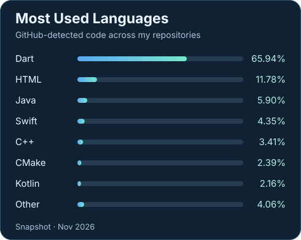

I’m Umer, a Flutter developer with around four years of experience building for iOS and Android. I build responsive screens, connect them to backend services, and help prepare apps for release. I care about keeping the code easy to change as a product grows.

## From screen to store

- **Build the interface.** Turn requirements into responsive Flutter screens and reusable components.
- **Connect the app.** Integrate backend services, sign-in, and real-time updates.
- **Prepare for release.** Diagnose crashes and prepare iOS and Android builds for the stores.

## Selected mobile work

| Project | Focus | Stack | Links |
| --- | --- | --- | --- |
| **SmartNPS360** | Security workforce app with shift tracking, field reporting, and location-aware workflows. | Flutter, REST APIs, Google Maps, Firebase Crashlytics | [Portfolio](https://umeraziz-p.vercel.app/#projects) |
| **Trevoo** | Social app with real-time chat and live sessions. My work focused on Flutter UI and Supabase-backed features. | Flutter, Supabase Realtime, Agora RTC, RevenueCat | [Live site](https://trevoo.app/) |
| **Amen** | Multilingual Bible and prayer app with guided devotional flows and scheduled local reminders. | Flutter, Firebase Auth, Cloud Firestore | [Portfolio](https://umeraziz-p.vercel.app/#projects) |
| **CampusCare** | College complaint management app with issue reporting, status tracking, and staff assignment. | Flutter, GetX, Firebase | [Portfolio](https://umeraziz-p.vercel.app/#projects) |

### More Flutter repositories

- **[Hive Notes](https://github.com/umarazizdev/Hive-Notes)** — A Flutter notes app backed by Hive local storage.
- **[Designer Digger](https://github.com/umarazizdev/Designer-Digger)** — A food-ordering app with authentication, favorites, and a shopping cart.

## Stack

**Mobile development**

  

**Backend & APIs**

    

**Version control & releases**

   

Language shares are a snapshot of GitHub-detected code bytes, aggregated across public and private repositories I own.

GitHub Activity

- [Contribution activity](https://github.com/umarazizdev?tab=overview#contribution-activity)
- [Browse public repositories](https://github.com/umarazizdev?tab=repositories)

## Connect

I’m happy to talk Flutter roles, mobile app development, or collaboration.

